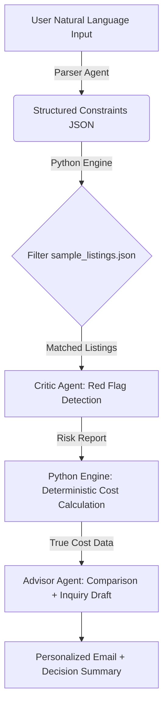

# London Rental Copilot 

> An AI product experiment born from the blood, sweat, and tears of renting in London
>
> AI-powered decision-support tool for navigating London's rental market.

[](YOUR_DEMO_LINK_HERE)
[](https://www.python.org/)
[](LICENSE)

---

## The Problem

Renting in London is broken. The average searcher spends **8+ hours/week** on property portals, yet still misses hidden costs, scams, and commute realities. Existing tools (Rightmove, Zoopla, OpenRent) are **search engines**, not **decision-support systems**.

## My Solution

An AI copilot that goes beyond filtering to **actively warn** and **contextualize**:

-  **Smart Requirement Parser**: Describe your ideal home in plain English — "2 bed, £1,800, 30 min to Canary Wharf, pet-friendly" — and get realistic zone recommendations you hadn't considered.
-  **Red Flag Detector**: AI scans listings for scam patterns, hidden costs, and description mismatches. Every warning includes an explanation.
-  **True Cost Calculator**: Compare properties by total monthly outlay (rent + council tax + commute + estimated utilities), not just headline rent.
-  **Instant Inquiry Drafter**: Generate personalized, polite enquiry emails in seconds — tailored to your profile and any red flags detected.

## Product Highlights

### 1. Multi-Agent Architecture with Deterministic Handoff
Three specialized agents (Parser, Critic, Advisor) connected by **deterministic Python routing** — LLM handles understanding and generation; Python handles filtering and arithmetic. This separation ensures predictable behavior in a high-stakes decision like housing.



**Why deterministic handoff matters**: When calculating rent + council tax + commute, a hallucinated number could cost a user hundreds of pounds. We deliberately route all calculations through tested Python logic, while LLMs only handle fuzzy tasks (parsing, tone generation, pattern recognition).

### 2. London-Specific Domain Knowledge
Integrated TfL zone data, council tax bands by borough, and area context. Product decision: prioritize **actionable local context** over generic LLM knowledge.

### 3. Explainable AI
Every red flag and recommendation shows its reasoning chain. Critical for high-stakes decisions like housing.

## Demo


> TODO: Record a 30-second demo GIF showing the full flow (Search → Flags → Compare → Email).

## Tech Stack

| Layer | Technology |
|-------|------------|
| Frontend | [Streamlit](https://streamlit.io/) |
| AI/LLM | OpenAI GPT-4o-mini (JSON mode) |
| Language | Python 3.10+ |
| Data | Local JSON/CSV (static dataset for MVP) |
| Testing | pytest + unittest.mock (zero-cost agent tests) |

## Project Structure

```text
london-rental-copilot/
├── docs/
│   ├── PRD.md                  # Product Requirements Document
│   ├── USER_RESEARCH.md        # Pain point validation
│   ├── COMPETITIVE_ANALYSIS.md # Rightmove/Zoopla gap analysis
│   └── PROMPT_DESIGN.md        # System prompt iterations
├── data/
│   ├── sample_listings.json         # 30 curated listings (MVP)
│   ├── borough_council_tax.json
│   ├── station_zone_map.json
│   └── travelcard_costs.json
├── app/
│   ├── main.py                      # Streamlit entry point
│   ├── agents/
│   │   ├── requirement_parser.py
│   │   ├── redflag_detector.py
│   │   ├── comparison_generator.py
│   │   └── inquiry_drafter.py
│   └── utils/
│       ├── cost_calculator.py
│       ├── tfl_commute.py
│       └── filter_engine.py         # Deterministic listing filter
├── tests/
│   ├── test_agents.py               # Mock-based agent tests
│   ├── test_filter_engine.py
│   ├── test_cost_calculator.py
│   ├── test_suggested_zones_full_chain.py
│   └── run_redflag_tests.py         # Integration test (real API)
├── notebooks/
│   └── prototype.ipynb              # Early experiments
├── .env.example
├── pytest.ini
├── README.md
└── requirements.txt
```

## Getting Started

### Prerequisites
- Python 3.10+
- OpenAI API key

### Installation

```bash
git clone https://github.com/YOUR_USERNAME/london-rental-copilot.git
cd london-rental-copilot
python -m venv venv
source venv/bin/activate  # On Windows: venv\Scripts\activate
pip install -r requirements.txt
```

### Configuration

Create a `.env` file in the project root:

```env
OPENAI_API_KEY=sk-...
```

### Run Locally

```bash
streamlit run app/main.py
```

### Run Tests

```bash
# Run all tests (mock tests run instantly; integration tests skip if no API key)
pytest tests/

# Run only unit tests (no API calls)
pytest tests/test_filter_engine.py tests/test_cost_calculator.py tests/test_agents.py
```

### Deploy

This app is configured for [Streamlit Community Cloud](https://streamlit.io/cloud) deployment. Connect your GitHub repo and it will auto-deploy.

## What I Learned (AI Product Takeaways)

- **Prompt engineering for structured output**: 2 iterations on RedFlagDetector took HIDDEN_COST recall from 0% to 100% while keeping clean-listing High-severity false positives at 0. Key lesson: explicit trigger-phrase lists + few-shot examples beat vague instructions.
- **Model behaviour divergence**: Switching from Deepseek to OpenAI (gpt-4o-mini) exposed a new false-positive pattern — the latter treated structured boolean fields (`bills_included: false`) as textual evidence. Fixed by filtering those fields from the LLM context, proving that **prompt design must be validated on every target model**.
- **Conservative classification design**: Calibrated RedFlagDetector for "better to miss a subtle flag than falsely accuse a legitimate landlord". Added extensive negative examples ("Do NOT flag 'Viewing highly recommended' as pressure"), driving marketing-language false positives to 0 on the test set.
- **Deterministic handoff architecture**: All wallet-impacting calculations (rent + council tax + commute) flow through tested Python functions, not LLM estimates. CostCalculator manually verified on 3 listings — error = £0.
- **Scope discipline**: Deliberately excluded live scraping, contract review, and chatbot UI to keep the 5-day MVP focused on what a hiring manager actually evaluates: prompt precision, agent orchestration, and product trade-off reasoning.

## Roadmap

- [x] v1.0 MVP: Parser + Red Flag + Comparison + Inquiry Drafter
- [ ] v1.1: Image analysis for stock-photo detection
- [ ] v1.2: Market-rate benchmarking (is this flat under/overpriced?)
- [ ] v2.0: Browser extension for Rightmove/Zoopla injection

## License

MIT

---

Currently seeking AI Product internship opportunities in London. If you're also building AI products or have any feedback, I'd love to connect via [LinkedIn/Email].

---

*Built with frustration-fueled passion during a London flat hunt.*
